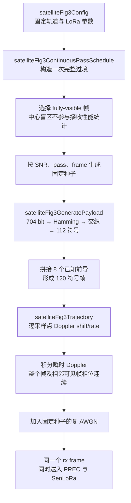
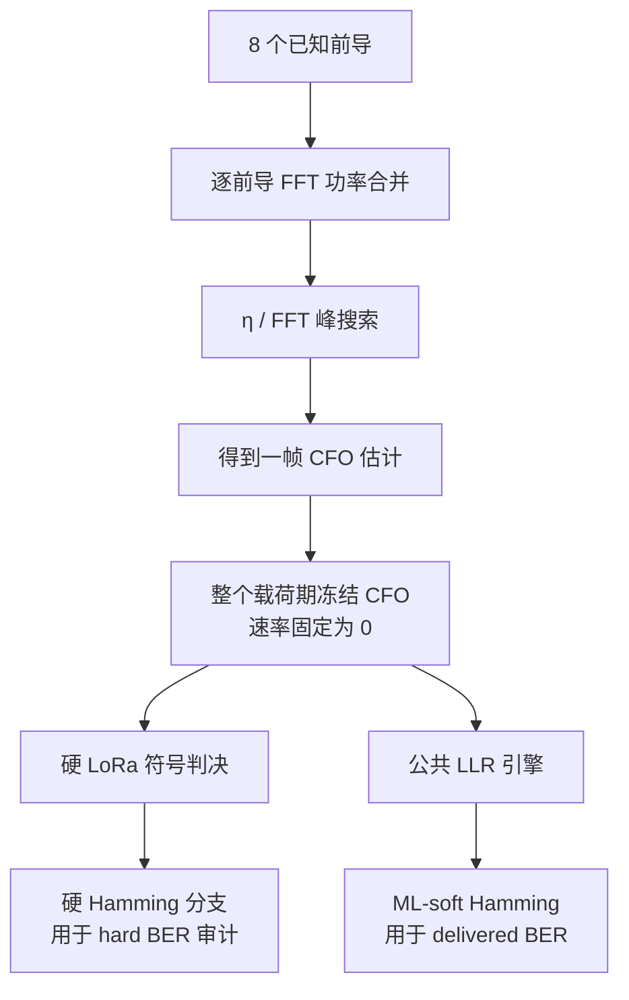
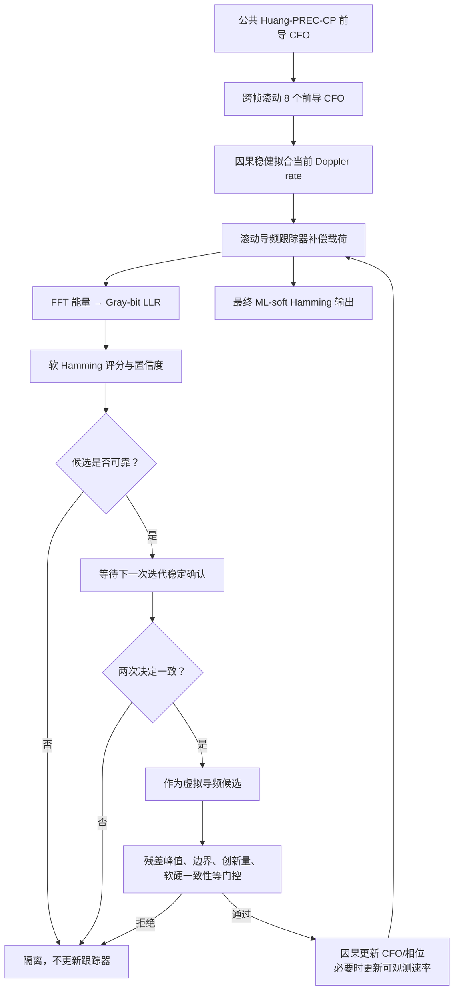
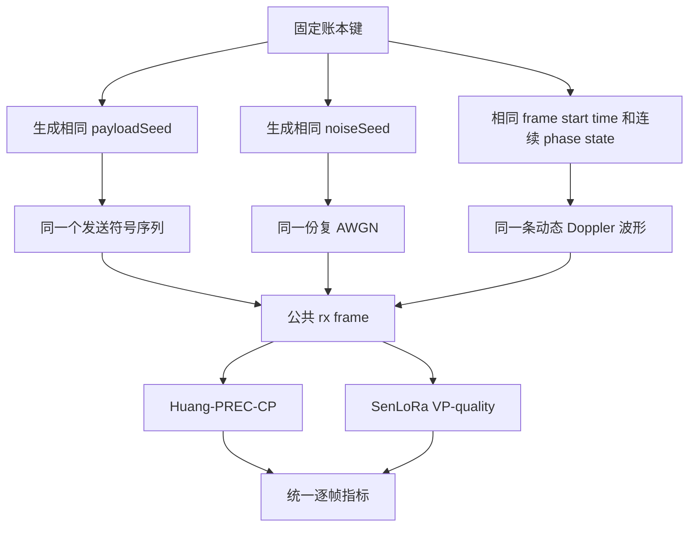
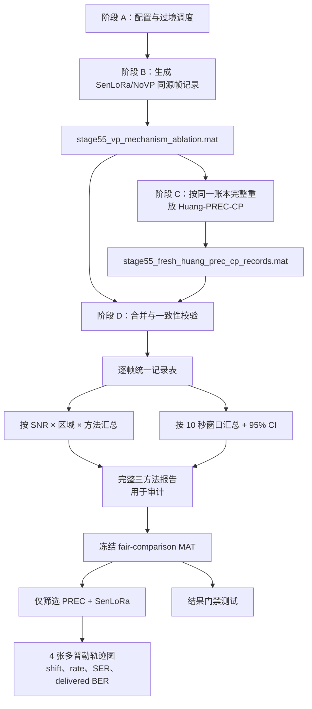

# Stage55 SenLoRa 与 Huang-PREC-CP 公平对比项目说明书

> 文档用途：让新的 ChatGPT/Codex 或项目成员在不依赖历史对话的情况下，理解项目目的、物理模型、算法差异、公平比较约束、实验数据流、结果含义和正确运行方式。
>
> 当前冻结结果：`-21/-20 dB × 3 次完整轨次`，每种接收方法共 2592 帧。本文档只描述当前 Stage55 主线，不把所有历史 Stage 实验混入主流程。

## 1. 一句话概括

本项目在同一套低轨卫星 LoRa 连续多普勒信道中，对比：

1. **Huang-PREC-CP**：依据黄鹏论文式 (4-1)～(4-7) 做前导 CFO 搜索，并在载荷期冻结 CFO；为适配跨符号连续相位，8 个前导采用 FFT 功率合并。
2. **SenLoRa（Stage55 VP-quality）**：使用相同的 Huang-PREC-CP 前导估计作为起点，再利用已接收帧的前导 CFO 历史估计因果 Doppler rate，并用质量门控的载荷虚拟导频持续修正 CFO、相位及可观测速率。

两条分支接收完全相同的波形，并使用相同的 ML-soft Hamming(7,4) 最终译码器。接收机层面的主要差异是：PREC 在载荷期冻结 CFO；SenLoRa 使用严格因果的跨帧前导 CFO 历史和可靠载荷虚拟导频进行动态跟踪。这两类观测都只来自接收信号，不是轨道先验或信道真值。

## 2. 研究问题与边界

### 2.1 要回答的问题

在低 SNR 和卫星动态多普勒条件下，SenLoRa 的因果虚拟导频跟踪能否比一帧一次、载荷期冻结 CFO 的 PREC 获得更低的 SER 和 BER？

### 2.2 不能通过什么方式得到“更好结果”

- 不能修改 SenLoRa 已冻结的逐帧结果。
- 不能给 PREC 和 SenLoRa 使用不同噪声、载荷、SNR 或信道波形。
- 不能只筛选对 SenLoRa 有利的帧。
- 不能改变 BER/SER 定义、隐藏失败帧或调整坐标制造视觉优势。
- 不能给任一接收机提供轨道真值、真实 CFO、真实载荷标签等不可见信息。
- 不能为了贴合论文代码而让 PREC 使用“每符号相位重置”的信道，同时让 SenLoRa 使用连续相位信道。

当前四个冻结实验组中 SenLoRa 的领先是仿真结果，不是绘图前提；不能外推为所有 SNR、轨道和参数条件下必然领先。

## 3. 项目目录与核心文件

项目根目录：

```text
D:\codex\lora（prec）\new（kua zhen chuan shu）
```

研究参考论文位于：

```text
D:\codex\参考论文\移动场景下的可靠LoRa通信方法_黄鹏.pdf
```

本文档中的“论文式 (4-1)～(4-7)”指该论文的 PREC/PRC 前导频偏估计部分。代码中的 `algorithmProvenance` 字段用于记录实现与论文的对应关系。

### 3.1 配置、信道和数据生成

| 文件 | 作用 |
|---|---|
| `satelliteFig3Config.m` | 统一保存轨道、LoRa、编码、置信门控和跟踪参数。 |
| `satelliteFig3Trajectory.m` | 根据圆轨道几何计算距离、径向速度、Doppler shift 和 Doppler rate。 |
| `satelliteFig3VisibilityWindow.m` | 计算可见区间与中心盲区。 |
| `satelliteFig3ContinuousPassSchedule.m` | 将一次过境划分为连续完整帧，标记 fully visible、blind 和 transition 帧。 |
| `satelliteFig3GeneratePayload.m` | 按种子生成数据位、Hamming 编码、交织和 LoRa 符号。 |
| `generateContinuousSatelliteFrame.m` | 生成跨符号连续相位的动态多普勒波形并添加复 AWGN。 |

### 3.2 Huang-PREC-CP 分支

| 文件 | 作用 |
|---|---|
| `satelliteFig3PaperPrecDecode.m` | 保留论文/原代码模型，主要用于算法溯源，不作为当前连续相位公平主基线。 |
| `satelliteFig3HuangPrecCpBootstrapEstimate.m` | 按论文的 η/CFO 搜索处理 8 个前导，但用逐前导 FFT 功率合并适配连续相位。 |
| `satelliteFig3HuangPrecStaticCpDecode.m` | 只在前导估计一次 CFO，载荷期冻结；无载荷反馈、无 Doppler-rate 跟踪、无轨道先验。 |
| `satelliteFig3HuangPrecCpMatchedDecode.m` | 在上述 PREC 前端后接入与 SenLoRa 相同的 ML-soft Hamming，形成公平对比支路。 |

### 3.3 SenLoRa 分支

| 文件 | 作用 |
|---|---|
| `satelliteFig3SenLoRaVirtualPilotDecode.m` | Stage55 SenLoRa 主入口；使用公共前导估计、跨帧因果速率估计和质量感知虚拟导频。 |
| `satelliteFig3CrossFrameRateUpdate.m` | 保存最近最多 8 帧的前导 CFO，用因果稳健拟合估计当前 Doppler rate；不使用轨道真值。 |
| `satelliteFig3SenLoRaIterativeDecode.m` | 最多 5 次迭代；两次稳定确认后才允许载荷符号成为虚拟导频。 |
| `satelliteFig3SenLoRaConfidence.m` | 由 FFT 能量构造 Gray-bit LLR，进行软 Hamming 评分、置信度计算和最终 ML-soft Hamming 译码。 |
| `satelliteFig3RollingPilotTracker.m` | 因果滚动 8 导频跟踪器，执行 CFO/相位预测、残差测量、质量门控和状态更新。 |

### 3.4 实验、报告和测试

| 文件 | 作用 |
|---|---|
| `run_stage55_vp_mechanism_ablation.m` | 生成同源的 NoVP 与 VP-quality SenLoRa 记录；当前最终比较使用其中 VP-quality。 |
| `run_stage55_huang_prec_cp_fresh_replay.m` | 按完全相同的帧账本重放 Huang-PREC-CP。 |
| `run_stage55_vp_quality_fresh_overall_report.m` | 合并逐帧记录，计算区域汇总、10 秒窗口统计、置信区间并生成完整报告。 |
| `plot_stage55_senlora_prec_ser_ber_trajectory.m` | 从冻结报告中筛出 SenLoRa 与 PREC，只绘制轨迹上下文、SER 和 delivered BER。 |
| `satelliteFig3HuangPrecCpMatchedDecodeTest.m` | 验证连续相位大正/负 CFO 恢复及无隐藏先验。 |
| `stage55FairHuangPrecComparisonTest.m` | 验证相同账本、SenLoRa 指标零变化以及四个冻结组的真实结果门禁。 |

## 4. 冻结物理与通信参数

| 参数 | 当前值 |
|---|---:|
| 载波频率 | 868 MHz |
| 轨道高度 | 550 km |
| 轨道倾角 | 15° |
| LoRa SF | 11 |
| 带宽 / 采样率 | 250 kHz / 250 kHz |
| 每符号采样点 | 2048 |
| 符号时长 | 8.192 ms |
| 编码率参数 | CR=3，即 Hamming(7,4) |
| 已知前导 | 8 个零值 upchirp |
| 载荷符号 | 112 |
| 每帧总符号 | 120 |
| 每帧时长 | 0.98304 s |
| 每帧有效数据 | 704 bit |
| 一次过境调度 | 508 个完整时间槽，其中 432 帧 fully visible |
| 中心盲区 | 约 `[-37.0824, 37.0824] s` |
| SNR | -21、-20 dB |
| 独立轨次 | 3 |
| 每种方法总帧数 | `432 × 2 × 3 = 2592` |
| 载荷种子基数 | 2026551800 |
| 噪声种子基数 | 2026551900 |
| 窗口统计宽度 | 10 s |

注意：这里的 `SampleSnrDb` 是单位平均功率复基带样本的 SNR。噪声生成为

```matlab
noiseVariance = 10^(-SampleSnrDb/10);
noise = sqrt(noiseVariance/2) * (randn(...) + 1i*randn(...));
```

因此 I/Q 两路各承担总复噪声方差的一半。本 Stage55 比较不是根项目正式 `-30:1:-16 dB` BER 网格扫描；不要混淆两套实验。

## 5. 信道生成流程



### 5.1 连续相位是关键假设

`generateContinuousSatelliteFrame` 不会在 LoRa 符号边界重置 CFO 相位，而是对瞬时 Doppler 进行梯形积分：

```text
phase[n] = phase[0] + 2π ∫ f_D(t) dt
```

同一可见段内，上一帧的下一帧起始相位会传递到下一帧。`truth` 中的真实 Doppler、相位和速度只允许用于评估误差，不允许进入接收机。

## 6. 为什么原始 PREC 在 Stage55 中异常失败

黄鹏论文/原代码的前导处理隐含了每个 LoRa 符号使用局部时间索引、符号间相位可对齐的模型。原实现先把 8 个前导作复数相干平均，再搜索 η 和 FFT 峰。

在本项目的跨符号连续相位信道中，不同前导带有不同全局相位。存在分数 CFO 时，直接复数平均会发生相消，使前导峰值显著下降，进而将 CFO 估计散布到错误 FFT bin。旧诊断中真实 CFO 约为 59～149 bin，而错误估计可散布到约 -1024～1019 bin。

### 6.1 当前公平修正

修正没有改变论文的 η/CFO 搜索，也没有改变公共信道。唯一的连续相位适配是：

```text
旧方式：abs( FFT( mean(complex_preambles) ) )²

当前方式：sum over preambles { abs( FFT(each_preamble) )² }
```

功率合并对每个前导的全局相位不敏感，避免相干平均相消。找到 `etaHat` 与整数峰位置后仍按论文关系得到：

```text
epsilonHatBins = signedIntegerBin - etaHatBins
```

载荷期 CFO 保持冻结。因此它仍然是 PREC 思路，而不是把 SenLoRa 的动态跟踪能力偷偷加入 PREC。


## 7. 两条接收机分支

### 7.1 公共起点

两路都使用：

- 同一个接收帧 `rxSymbols`；
- 同一个 8 前导 Huang-PREC-CP CFO 初值；
- 同一 SF/BW/CR 和帧结构；
- 同一个最终 ML-soft Hamming(7,4) 译码引擎。

### 7.2 Huang-PREC-CP



明确禁止项：

- `usesPayloadFeedback = false`
- `usesDopplerRate = false`
- `usesOrbitPrior = false`
- 接受虚拟导频数始终为 0

### 7.3 SenLoRa Stage55 VP-quality

SenLoRa 的核心增益来自“只有可靠的载荷决定才成为虚拟导频，并且更新严格因果”。



关键约束：

1. 一个 7 符号 Hamming 块的置信结果，要等整块接收完毕后，最早在下一符号才能用于跟踪，不能反向补偿产生它的块。
2. 第一次迭代只能提出候选；至少两次迭代稳定且决定一致后才进入请求集合。
3. 软译码结果默认只作为置信门控，虚拟导频标签使用补偿后的硬 LoRa 判决，防止软译码器自我强化。
4. 跨帧速率只来自已经接收的前导 CFO 历史；没有轨迹先验或真值。
5. 质量感知模式使用受限创新增益、相位对一致性和速率可观测性约束。
6. 最多进行 5 次迭代，接受集合单调增长，但滚动状态只保留最新 8 个有效导频。

## 8. 公平实验账本

每一帧由以下键唯一确定：

```text
(snrDb, passIndex, segmentIndex, frameIndex, payloadSeed, noiseSeed)
```

种子按固定公式生成：

```text
payloadSeed = PayloadSeedBase + 1,000,000*snrIndex
              + 10,000*passIndex + frameIndex

noiseSeed   = NoiseSeedBase + 1,000,000*snrIndex
              + 10,000*passIndex + frameIndex
```

PREC 重放函数不复用 SenLoRa 的解码结果，而是用相同账本重新生成同一载荷、同一噪声和同一连续相位波形，然后只替换接收算法。



`stage55FairHuangPrecComparisonTest` 会逐项比较两套配置、调度、可见段和上述账本，防止不公平输入。

## 9. 区域划分

项目不是简单按“有无频偏”划分，而是按一帧内由 Doppler rate 造成的漂移量划分：

```text
driftBinsPerFrame = |dopplerRateHzPerSec| × frameDurationSec
                    / fftBinSpacingHz
```

- `driftBinsPerFrame >= 0.5`：`high_doppler_rate`，即高频偏变化率区域，靠近过境中心两侧。
- `driftBinsPerFrame < 0.5`：`high_doppler_shift`，即绝对频移较大但帧内变化较慢的外侧区域。

这解释了为什么 PREC 在高变化率区域明显更差：它只估计一次 CFO 并在约 0.9175 s 的载荷期间冻结，无法跟随帧内变化。大但近似静态的 CFO 反而是 PREC 本来能够补偿的情形。

## 10. 指标定义

### 10.1 SER

```text
SER = 错误载荷 LoRa 符号数 / 载荷符号总数
```

比较的是 112 个载荷符号的硬 LoRa 判决。

### 10.2 Hard BER

```text
hard BER = 硬符号判决经相同硬 Hamming 解码后的错误位 / 总数据位
```

它主要用于隔离 CFO 跟踪/符号检测能力，避免软译码器差异影响主算法判断。

### 10.3 Delivered BER

```text
delivered BER = 共同 ML-soft Hamming 输出的错误位 / 总数据位
```

最新两方法多普勒轨迹图中的“BER”使用此口径，因为两条分支已经共享完全相同的 ML-soft Hamming 引擎。

### 10.4 PER

只要一帧 delivered bits 中存在至少 1 个错误，该帧计为包错误。

### 10.5 CFO RMSE

```text
CFO RMSE = sqrt(sum((predictedCfoBins - trueCfoBins)^2) / 样本数)
```

真实 CFO 只在这里作为离线评价真值使用。

### 10.6 置信区间和零错误显示

区域汇总还包含 3 次独立轨次的均值和 95% CI。轨迹图按 10 秒窗口汇总，并使用 `satelliteFig3BerInterval95` 产生对数图可显示值及 95% 区间。零错误窗口不能直接在对数轴画成 0，因此图中使用统计函数给出的显示值，而不是篡改原始误码计数。

## 11. 当前冻结结果

### 11.1 硬 BER：用于跟踪算法公平审计

| SNR | 区域 | Huang-PREC-CP | SenLoRa | PREC/SenLoRa |
|---:|---|---:|---:|---:|
| -21 dB | 高频偏变化率 | 0.0979256 | 0.00567496 | 17.26× |
| -21 dB | 高频移 | 0.0123509 | 0.00484919 | 2.55× |
| -20 dB | 高频偏变化率 | 0.0498463 | 0.000288208 | 172.95× |
| -20 dB | 高频移 | 0.00245117 | 0.000355919 | 6.89× |

### 11.2 最新轨迹图使用的 SER 与 delivered BER

| SNR | 区域 | 方法 | SER | Delivered BER |
|---:|---|---|---:|---:|
| -21 dB | 高频偏变化率 | Huang-PREC-CP | 0.486219 | 0.0840882 |
| -21 dB | 高频偏变化率 | SenLoRa | 0.0483523 | 0.000881780 |
| -21 dB | 高频移 | Huang-PREC-CP | 0.0729875 | 0.00453837 |
| -21 dB | 高频移 | SenLoRa | 0.0483783 | 0.000837456 |
| -20 dB | 高频偏变化率 | Huang-PREC-CP | 0.424905 | 0.0528141 |
| -20 dB | 高频偏变化率 | SenLoRa | 0.0106539 | 0.0000789141 |
| -20 dB | 高频移 | Huang-PREC-CP | 0.0241740 | 0.000832625 |
| -20 dB | 高频移 | SenLoRa | 0.0100826 | 0.0000386518 |

进一步观察：

- SenLoRa 的误接纳虚拟导频在四组中均为 0。
- PREC 在高变化率区的 CFO RMSE 约 0.52 bin，SenLoRa 约 0.05 bin。
- 高频移区二者差距较小，但 SenLoRa 仍因载荷期跟踪得到更低 BER。
- -20 dB 时 SenLoRa 平均接受约 6.8～6.9 个虚拟导频/帧；-21 dB 时约 3.2～3.4 个/帧，体现低 SNR 下门控更加保守。

## 12. 从仿真到最终图的完整流程



## 13. 输出目录与数据血缘

### 13.1 帧级新鲜结果

```text
results/stage55_vp_quality_fresh_rerun_20260812/
```

关键文件：

- `stage55_vp_mechanism_ablation.mat`：NoVP/VP-quality 原始逐帧结果、配置、调度和种子参数。
- `stage55_fresh_huang_prec_cp_records.mat`：Huang-PREC-CP 的同账本逐帧重放。

### 13.2 公平完整报告

```text
results/stage55_huang_prec_cp_fair_comparison_20260812/
```

关键文件：

- `stage55_fresh_three_method_frame_records.csv`
- `stage55_fresh_three_method_window_statistics.csv`
- `stage55_fresh_three_method_region_summary.csv`
- `stage55_fresh_three_method_overall_report.mat`
- `stage55_vs_huang_prec_cp_fair_audit.csv`

这里仍保留 NoVP，目的是审计 SenLoRa 的机制变化；不要把它误认为最新论文对比图必须显示的第三种算法。

### 13.3 最新双方法轨迹图

```text
results/stage55_senlora_prec_ser_ber_trajectory_20260813/
```

该目录只包含 Huang-PREC-CP 与 SenLoRa 的筛选结果及 4 张图：

- `-21 dB × high_doppler_rate`
- `-21 dB × high_doppler_shift`
- `-20 dB × high_doppler_rate`
- `-20 dB × high_doppler_shift`

每张图由四个面板组成：

1. Doppler shift 轨迹；
2. Doppler rate 轨迹；
3. 10 秒窗口 SER 与 95% 区间；
4. 10 秒窗口 delivered BER 与 95% 区间。

NoVP 已被过滤，且筛选后的数值与公平报告逐项相同，最大差值为 0。

## 14. 正确运行方式

运行前，将 MATLAB 当前目录切换到项目根目录。

### 14.1 只重绘最新两方法结果（推荐用于看图）

该命令不进行帧级仿真，只读取冻结 MAT：

```matlab
report = plot_stage55_senlora_prec_ser_ber_trajectory();
disp(report.figureManifest);
```

### 14.2 重新生成完整统计报告

前提是 `stage55_vp_quality_fresh_rerun_20260812` 内的两套帧记录都已存在：

```matlab
report = run_stage55_vp_quality_fresh_overall_report( ...
    FreshResultFolder=fullfile(pwd,'results', ...
        'stage55_vp_quality_fresh_rerun_20260812'), ...
    OutputFolderName='stage55_huang_prec_cp_fair_comparison_new', ...
    RunRuntimeBenchmark=false, ...
    ReferenceRecordFileName='stage55_fresh_huang_prec_cp_records.mat', ...
    ReferenceMethodName='Huang-PREC-CP', ...
    ReferenceMethodLabel='Huang-PREC-CP (ML-soft)', ...
    ReferenceUsesContinuousPhasePowerCombining=true, ...
    ReferenceUsesMatchedSoftDecode=true);
```

### 14.3 完整重放 Huang-PREC-CP（较慢）

```matlab
report = run_stage55_huang_prec_cp_fresh_replay();
```

它会处理 2592 帧。运行前应先确认输出目录，避免覆盖需要保留的结果。新实验建议指定新的 `OutputFolderName`。

### 14.4 完整重跑 SenLoRa 数据（最需谨慎）

```matlab
report = run_stage55_vp_mechanism_ablation( ...
    SnrGridDb=[-21;-20], ...
    PassCount=3, ...
    FramesPerVisibleSegment=Inf, ...
    PayloadSeedBase=2026551800, ...
    NoiseSeedBase=2026551900, ...
    OutputFolderName='stage55_new_experiment', ...
    IncludeQualityMode=true, ...
    QualityFinalOnly=true);
```

若要和冻结结果公平复现，参数和种子必须保持一致。若改变算法、参数或种子，应使用新目录并明确标注为新实验，不能覆盖冻结基线。

## 15. 测试与结果门禁

### 15.1 PREC 单元测试

`satelliteFig3HuangPrecCpMatchedDecodeTest` 检查：

- 无噪声连续相位下大正/负 CFO 能被正确恢复；
- 硬/软数据位能正确解码；
- 接收机明确不使用载荷反馈、Doppler rate 或轨道先验；
- 算法溯源和共同译码口径存在。

### 15.2 公平结果门禁

`stage55FairHuangPrecComparisonTest` 检查：

1. PREC 和 Stage55 的 `config`、`schedule`、`segments`、SNR、pass 数与逐帧种子账本完全一致。
2. 新报告中的 SenLoRa/NoVP 指标与修正前逐项严格相同，`AbsTol=0`。
3. 在当前冻结四组中，SenLoRa 的 SER、hard BER、delivered BER 和 CFO RMSE 都实际低于 Huang-PREC-CP。

机器全局路径可能存在 BELLHOP 的 `runtests.m`，会遮蔽 MATLAB 官方运行器。不要直接依赖裸 `runtests`。在 MATLAB R2022a 中可使用：

```matlab
suite1 = matlab.unittest.TestSuite.fromFile( ...
    fullfile(pwd,'satelliteFig3HuangPrecCpMatchedDecodeTest.m'));
suite2 = matlab.unittest.TestSuite.fromFile( ...
    fullfile(pwd,'stage55FairHuangPrecComparisonTest.m'));
runner = matlab.unittest.TestRunner.withTextOutput;
results = runner.run([suite1 suite2]);
assert(all([results.Passed]));
```

## 16. ChatGPT 修改项目时必须遵守的规则

### 16.1 先判断任务属于哪一层

- 只改图例、方法筛选、面板：读取冻结报告重绘，不重跑通信仿真。
- 改统计口径：从逐帧记录重新汇总，并同时保存旧口径，说明差异。
- 改 PREC 或 SenLoRa 接收算法：先做少量 smoke，再跑完整同账本实验。
- 改物理模型、SNR、帧结构或种子：这是新实验，必须使用新结果目录。

### 16.2 绝不能破坏的数据血缘

- `truth` 只能计算 CFO RMSE，不能传入接收算法。
- 帧顺序和跨帧状态必须按时间因果顺序处理。
- PREC 与 SenLoRa 必须共享载荷、噪声、起始时间和连续相位状态。
- SenLoRa 已冻结结果不可为配合新参考算法而改动。
- 任何新图都应能追溯到具体 MAT/CSV，不允许手填曲线或修改数据点。

### 16.3 修改后最低验证要求

1. MATLAB Code Analyzer 无新问题。
2. 针对修改模块运行单元测试。
3. 若影响接收算法，运行固定少量帧 smoke。
4. 若要得出最终性能结论，运行完整 2592 帧同账本实验。
5. 对比新旧 SenLoRa 指标；若声称未改 SenLoRa，最大差值必须为 0。
6. 目视检查 PNG，并核对图例、区域、SNR、坐标和数据表一致。

## 17. 常见误解

### 误解 1：高频偏一定比高变化率更难

不一定。PREC 能估计并补偿较大的近似静态 CFO；真正使载荷期冻结 CFO 失效的是帧内快速变化。因此本项目中高 Doppler rate 区通常比高 Doppler shift 区更能拉开差距。

### 误解 2：PREC 修正后已经变成 SenLoRa

不是。PREC 只改变了 8 前导的相位不敏感合并方式；载荷期依然冻结 CFO，且不使用载荷反馈、速率估计或虚拟导频。

### 误解 3：最新 BER 图画的是 hard BER

不是。最新轨迹图的 BER 是两路经过共同 ML-soft Hamming 后的 delivered BER。hard BER 保留在公平汇总表中，用于跟踪算法审计。

### 误解 4：NoVP 数据被删除了

没有。NoVP 仍保存在完整消融和公平报告中，只是在最新论文式两方法轨迹图中被筛除。

### 误解 5：图上零错误窗口可以直接画成 0

对数轴不能显示 0。应使用项目统计函数生成的显示值和区间，同时保留原始 `errorCount=0`，不能任意设定一个视觉下限冒充观测 BER。

## 18. 可直接复制给新 ChatGPT 的上下文提示

```text
你正在处理一个 MATLAB R2022a 项目：Stage55 低轨卫星 LoRa 动态多普勒公平对比。

项目根目录：
D:\codex\lora（prec）\new（kua zhen chuan shu）

先完整阅读 STAGE55_CHATGPT_PROJECT_GUIDE.md，再检查与当前任务直接相关的代码。

当前主比较是 Huang-PREC-CP 与 Stage55-VP-quality SenLoRa：
- 两路使用完全相同的 SF11、250 kHz、8 前导、112 载荷符号、Hamming(7,4)、载荷、噪声、连续相位多普勒波形和帧账本。
- PREC 根据黄鹏论文式 (4-1)～(4-7) 搜索 η/CFO；为适配连续相位，逐前导 FFT 功率求和；载荷期冻结 CFO，无载荷反馈、无速率跟踪、无轨道先验。
- SenLoRa 使用相同前导估计，然后以因果、两次稳定确认、质量门控的虚拟导频更新 CFO/相位/可观测速率。
- 两路最终均使用相同 ML-soft Hamming。最新轨迹图的 BER 是 delivered BER；hard BER 仅用于算法公平审计。
- 冻结实验为 -21/-20 dB、3 次完整轨次、每种方法 2592 帧。
- 不得改变 SenLoRa 已有结果，不得筛选有利帧、修改误码定义或手工调整曲线。
- truth 只能用于离线评价，不能进入接收机。
- 只修改图时读取冻结 MAT 重绘，不要重跑长仿真。
- 修改接收算法时先 smoke，再用同一账本完整重放，并运行公平门禁。
- BELLHOP 的 runtests.m 可能遮蔽官方函数；使用 matlab.unittest.TestSuite.fromFile 与 TestRunner。

冻结公平报告：
results/stage55_huang_prec_cp_fair_comparison_20260812/

最新两方法 SER/BER 轨迹图：
results/stage55_senlora_prec_ser_ber_trajectory_20260813/

在行动前先说明：将改动哪个层级、会不会改变实验数据、需要运行 smoke 还是完整重放。
```

## 19. 最终理解检查清单

一个 ChatGPT 真正理解项目后，应能正确回答：

1. 为什么原始复数平均 PREC 在连续相位信道中会失败？
2. 功率合并修正了什么，又明确没有加入什么能力？
3. SenLoRa 相对 PREC 增加了哪两类严格因果的动态跟踪信息？
4. 为什么虚拟导频必须两次稳定确认且延迟到后续符号才可用？
5. 为什么高变化率区域比高频移区域更能体现 SenLoRa 优势？
6. hard BER 与 delivered BER 分别回答什么问题？
7. 如何证明两路使用同一批帧？
8. 为什么只改图时不能重跑或重新生成误码数据？
9. 哪些变量属于接收机可见信息，哪些只能作为评估 truth？
10. 修改算法后，哪些测试和结果门禁必须通过？

如果上述问题不能准确回答，应继续阅读第 5～16 节，而不要直接修改算法或结果图。
