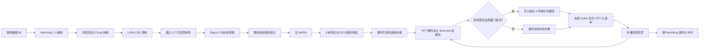
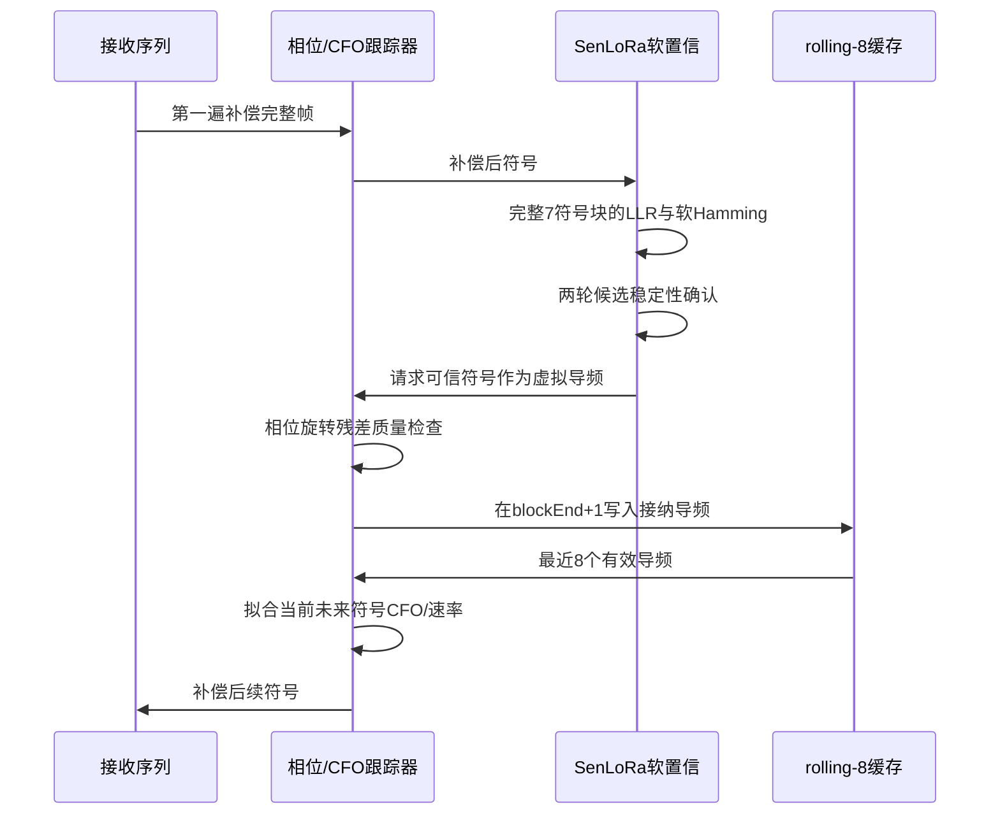
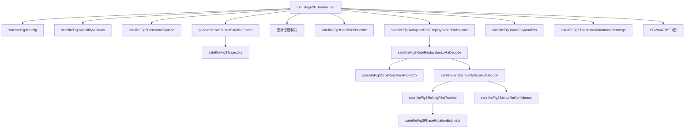
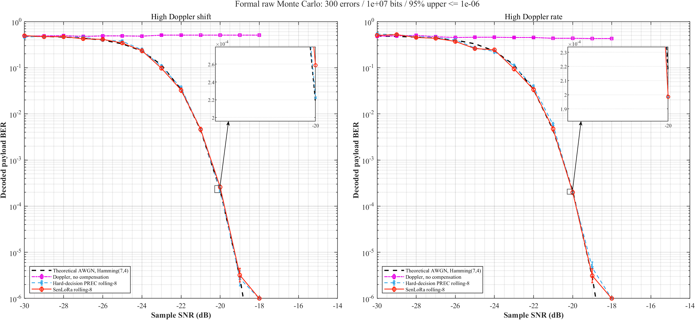

# SenLoRA 动态多普勒补偿：算法、源码与仿真实验详解

> 工程根目录：`D:\codex\Lora(eg)\project\orbit_doppler\satellite_fig3_rolling8`  
> 文档依据：当前 MATLAB 源码、回归测试、Stage 45 正式结果以及 `D:\codex\lora(CFO)` 的 Figure-3 轨道模型  
> 更新时间：2026-08-06

---

## 0. 阅读前必须澄清的名称问题

本工程中的 **SenLoRa** 是一种 LoRa 软信息置信符号检测与动态虚拟导频方法。它使用 FFT 能量、Gray bit LLR、软 Hamming(7,4)、置信阈值和残差质量门来选择虚拟导频。

它**不是**大模型领域的低秩适配器 LoRA（Low-Rank Adaptation），工程中不存在：

- 神经网络主干；
- 低秩矩阵 `A/B`；
- `W + BA` 权重更新；
- optimizer、learning rate 或反向传播；
- 在线梯度训练。

因此，参考模板中关于“LoRA rank、LoRA 插入层、冻结主干、在线损失函数”的项目，在本工程中均应标记为 **未实现/不适用**。当前虚拟导频更新的是传统接收机的 **CFO、多普勒速率和累计相位状态**。

---

## 1. 一分钟理解整个项目

1. 工程模拟一个地面终端与一颗 LEO 卫星的一次可见窗口，不是两个设备。
2. 轨道条件为 `fc=868 MHz`、高度 `550 km`、倾角 `15°`，LoRa 参数为 `SF=11`、`BW=Fs=250 kHz`。
3. 每帧有 8 个已知零前导和 112 个载荷符号。
4. 8 个前导首先估计大整数 CFO、亚 bin CFO、起始相位和初始多普勒速率。
5. 载荷经初步补偿后，SenLoRa 按 7 符号 Hamming 块计算软置信度。
6. 高置信符号还必须经过两轮判决稳定、软硬一致和相位旋转残差质量检查。
7. 被接纳的当前硬判决符号充当虚拟导频；发送真值不进入接收机。
8. 跟踪器只保留最近 8 个有效导频，新的导频覆盖最旧导频。
9. 最近 8 个导频加权拟合下一可用符号的 CFO 和多普勒速率；累计相位状态连续递推。
10. 正式 BER 比较理论 AWGN、无补偿、硬判决 PREC rolling-8 和 SenLoRa rolling-8。

---

## 2. 研究背景与问题定义

### 2.1 通俗解释

LoRa 符号依靠解调后的 FFT 峰值位置识别符号。卫星高速运动会产生数 kHz 到约 18 kHz 的多普勒频偏，而且频偏随时间变化。若接收机只在帧开始估计一次频偏，帧后部会因为多普勒速率产生越来越大的残差，FFT 峰值发生偏移，最终导致符号和比特错误。

工程采用的思路是：

1. 用已知前导启动接收机；
2. 从已经解出的载荷中筛选极可信的符号；
3. 将这些符号当作“虚拟导频”；
4. 用它们持续更新频偏、速率和相位预测；
5. 使用更新后的状态补偿后续符号。

### 2.2 技术表述

接收符号可以写成

\[
y[n]=x[n]e^{j\phi_D[n]}+w[n],
\]

其中 \(x[n]\) 是 LoRa CSS 复基带样本，\(w[n]\) 是复高斯白噪声，动态多普勒相位满足

\[
\phi_D[n]=2\pi\int_0^{t_n} f_D(\tau)\,d\tau.
\]

接收机使用预测相位

\[
\hat\phi(t)=\hat\phi_0+2\pi\left(\hat f_Dt+rac12\hat{\dot f}_Dt^2\right)
\]

进行补偿。SenLoRa 的作用不是直接修改神经网络，而是选择可用于更新 \(\hat f_D\)、\(\hat{\dot f}_D\) 和 \(\hat\phi_0\) 的高可信载荷符号。

---

## 3. 系统模型与数组形状

### 3.1 完整链路



### 3.2 固定形状

| 对象 | MATLAB 形状 | 类型 | 说明 |
|---|---:|---|---|
| 单个 LoRa 符号 | `1 × 2048` | complex double | `M=2^SF=2048` 个采样 |
| 整帧发送/接收波形 | `120 × 2048` | complex double | 8 前导 + 112 载荷 |
| 载荷符号标签 | `112 × 1` | double | 取值 `0...2047` |
| 一个 Hamming 块的数据 bit | `11 × 4` | double/logical | 11 条并行 Hamming 码字 |
| 一个 Hamming 块编码结果 | `11 × 7` | double/logical | 产生 7 个 LoRa 符号 |
| 全帧数据 bit | `11 × 4 × 16` | double | 共 704 payload bit |
| rolling 导频索引/CFO | `8 × 1` | double | 最近 8 个有效导频 |
| 每符号 CFO/速率预测 | `120 × 1` | double | 单位分别为 bin、bin/s |

源码依据：

- `satelliteFig3Config.m:20-31`
- `satelliteFig3GeneratePayload.m:12-39`
- `generateContinuousSatelliteFrame.m:14-38`
- `satelliteFig3RollingPilotTracker.m:74-100`

---

## 4. 发送端、编码与检测

### 4.1 Hamming(7,4) 编码

`satelliteFig3GeneratePayload.m` 将每 4 个数据 bit 编成 7 bit：

\[
\mathbf c=[d_1,d_2,d_3,d_4,p_1,p_2,p_3],
\]

\[
p_1=d_1\oplus d_2\oplus d_4,\quad
p_2=d_1\oplus d_3\oplus d_4,\quad
p_3=d_2\oplus d_3\oplus d_4.
\]

对应代码为 `satelliteFig3GeneratePayload.m:22-34`。

### 4.2 LoRa CSS 调制

离散上啁啾为

\[
x_k[n]=\exp\left[j2\pi\left(\frac{n^2}{2M}-\frac n2+\frac{kn}{M}\right)\right],
\]

实现位于 `satelliteFig3ModulateSymbol.m:8-10`。

### 4.3 硬判决

接收端用本地上啁啾共轭去啁啾，然后执行 FFT：

\[
\hat k=\arg\max_m\left|\operatorname{FFT}\{y[n]x_0^*[n]\}[m]\right|.
\]

实现位于 `satelliteFig3HardDecision.m:10-24`。同时输出第一峰与第二峰之比 `peakRatio`，作为判决质量指标。

---

## 5. Figure-3 轨道与动态多普勒信道

### 5.1 配置参数

| 参数 | 当前值 | 单位 | 当前配置位置 | `lora(CFO)` 对照 | 一致性 |
|---|---:|---|---|---|---|
| 光速 | `3e8` | m/s | `satelliteFig3Config.m:8` | `lora_orbit_doppler_config.m:9` | 完全一致 |
| 地球半径 | `6371e3` | m | `satelliteFig3Config.m:10` | 对照文件第 11 行 | 完全一致 |
| 地球自转角速度 | `7.292e-5` | rad/s | 第 11 行 | 对照文件第 12 行 | 完全一致 |
| 轨道高度 | `550e3` | m | 第 12 行 | 对照文件第 13 行 | 完全一致 |
| 倾角 | `15` | deg | 第 13 行 | 对照文件第 14 行 | 完全一致 |
| 载频 | `868e6` | Hz | 第 14 行 | 对照文件第 15 行 | 完全一致 |
| 仰角范围 | `10/50/56` | deg | 第 15–17 行 | 对照文件第 16–18 行 | 完全一致 |
| SF | `11` | — | 第 20 行 | 当前实验条件 | — |
| BW=Fs | `250e3` | Hz | 第 21–22 行 | `apply_lora_dynamic_doppler.m` 默认值 | 一致 |

### 5.2 轨道公式

轨道半径为

\[
R_s=R_E+H.
\]

卫星角速度和考虑地球自转后的相对角速度为

\[
\omega_s=\sqrt{\frac{gR_E^2}{R_s^3}},\qquad
\omega_f=\omega_s-\omega_E\cos i.
\]

径向速度 \(v_r(t)\) 和径向加速度 \(a_r(t)\) 由 `satelliteFig3Trajectory.m:16-30` 计算，多普勒为

\[
f_D(t)=-\frac{f_cv_r(t)}c,qquad
\dot f_D(t)=-\frac{f_ca_r(t)}c.
\]

当前 `satelliteFig3Trajectory.m:16-32` 与 `D:\codex\lora(CFO)\lora_orbit_doppler_trajectory.m:22-53` 的公式一致。

### 5.3 正式信道使用精确逐采样轨道

正式生成器在整帧所有采样时刻调用 `satelliteFig3Trajectory`，并使用完整 RF 瞬时频率：

\[
f_D[n]=-rac{(f_c+f_{BB}[n])v_r[n]}c.
\]

相位采用梯形积分：

\[
\phi_D[n]=\phi_D[n-1]+\frac{\pi}{F_s}\left(f_D[n-1]+f_D[n]\right).
\]

对应 `generateContinuousSatelliteFrame.m:27-38`。相位只在整帧开始设为零，不在符号边界重置。

### 5.4 两个正式场景

`run_stage26_formal_ber.m:28-34` 定义：

- 高频偏：`startTimeSec = -window.deltaTimeOutSec`；
- 高速率：`startTimeSec = +window.deltaTimeInSec`。

这两个点来自同一个单设备可见窗口，不代表两个设备。

### 5.5 精确模型与分段线性模型的关系

工程包含 `satelliteFig3PiecewiseDoppler.m`，用于验证论文式分段线性近似，但 Stage 45 正式信道不调用它，而直接调用精确轨道。

因此应表述为：

> 正式仿真采用论文 Figure-3 的轨道几何和动态多普勒轨迹，但信道实现是更精确的逐采样完整 RF 模型，而非把分段线性近似直接作为信道。

轨迹图：


精确与分段近似对照：


---

## 6. 初始 8 导频启动

### 6.1 导频位置与标签

帧前 8 个符号固定为零符号：

```matlab
known = zeros(config.bootstrapPilotCount,1);
labels = [known;payload.symbolBins];
```

见 `run_stage26_formal_ber.m:52-65`。接收机知道这 8 个前导标签，但不知道载荷标签。

### 6.2 大 CFO 和亚 bin 估计

`satelliteFig3BootstrapEstimate.m` 的处理为：

1. 8 个前导去除已知 LoRa 波形；
2. 聚合 FFT 功率，估计大整数 CFO；
3. 在粗 CFO 周围按 `0.05 bin` 搜索；
4. 对每个前导执行相位旋转估计；
5. 对 8 个连续前导进行联合二次相位拟合。

二次相位拟合写成

\[
\phi(k)\approx \beta_0+2\pi\beta_1k+\pi\beta_2k^2,
\]

其中一次项对应残余 CFO，二次项对应多普勒速率。实现位于 `satelliteFig3BootstrapJointPhaseEstimate.m:31-47`。

### 6.3 轨道速率先验

正式接收机还使用粗前导 CFO 在已知 Figure-3 轨迹上反查大致轨道时刻，从而得到接收机可见的速率先验：

```text
coarse CFO → estimated orbit time → Doppler rate prior
```

实现位于 `satelliteFig3OrbitRatePriorFromCfo.m:13-28`。函数接口不接收载荷标签、仿真起始真值或 `truth` 数组。

---

## 7. SenLoRa 软置信度

### 7.1 FFT 能量到符号概率

对每个 FFT bin 的能量 \(E_m\)，以前导估计噪声功率 \(\sigma_n^2\)，形成归一化 log probability：

\[
\ell_m=\frac{E_m}{\sigma_n^2}-\log\sum_q\exp\left(\frac{E_q}{\sigma_n^2}\right).
\]

实现位于 `satelliteFig3SenLoRaConfidence.m:31-59`。

### 7.2 Gray bit LLR

第 \(b\) 个 Gray bit 的 LLR 为

\[
L_b=\log\sum_{m:b_m=1}e^{\ell_m}-
\log\sum_{m:b_m=0}e^{\ell_m}.
\]

代码位于 `satelliteFig3SenLoRaConfidence.m:55-59`。

### 7.3 软 Hamming 与置信度

每条 Hamming 码字从 16 个合法码字中选择得分最高者，同时计算最佳和次佳码字得分差。修正后的符号置信度为

\[
C_s=\sum_{b=1}^{SF}|L'_{s,b}|^2.
\]

块阈值为

\[
\tau_{block}=\operatorname{mean}(C_s)+\operatorname{std}(C_s),
\]

全局 EMA 阈值为

\[
\tau_g^{(q)}=0.8\tau_g^{(q-1)}+0.2\tau_{block}^{(q)}.
\]

对应代码：

- 软 Hamming：`satelliteFig3SenLoRaConfidence.m:150-168`；
- `sum|LLR|²`：第 67 行；
- 块阈值和 EMA：第 68–74 行；
- `confidentMask`：第 75–85 行。

### 7.4 正式候选条件

`satelliteFig3SenLoRaIterativeDecode.m:76-96` 还要求：

1. 置信度超过全局阈值；
2. Hamming margin/global threshold ≥ 0.25；
3. 软判符号和当前硬判符号一致；
4. 两次迭代连续提出同一符号；
5. 第一轮只提名，不接纳。

因此，`ConfidentFlag=true` 只是第一层条件，并不等于最终虚拟导频已经写入跟踪器。

---

## 8. 虚拟导频与 rolling-8

### 8.1 直接结论

**结论：已实现。**

- SenLoRa 软信息用于判断符号是否可信；
- 最终虚拟导频标签来自补偿后的当前硬 LoRa 判决；
- 发送端真实标签不进入接收机；
- 虚拟导频用于估计 CFO、速率和相位，不更新神经网络；
- 活动窗口固定为最近 8 个有效导频；
- 每帧累计接纳总数不固定，可以为 0，也可以超过 8；
- 新导频覆盖最旧导频。

### 8.2 为什么正式标签使用硬判决

正式配置：

```matlab
config.senloraUseSoftDecodedPilotLabels = false;
```

见 `satelliteFig3Config.m:55-61`。这是为了让最终 BER 与硬判决 Hamming 理论基准口径一致。SenLoRa 软信息仍然决定“是否相信该符号”，但不会把软译码带来的额外编码增益混入补偿对比。

### 8.3 残差质量门

高置信候选还要经过相位旋转残差估计，满足：

\[
\text{peakRatio}\ge1.05,
\]

峰值不能在搜索边界，且

\[
|\hat\epsilon|\le0.22\ \text{bin}.
\]

实现位于 `satelliteFig3RollingPilotTracker.m:156-178` 和 `217-240`。

### 8.4 环形缓存

窗口长度由

```matlab
config.virtualPilotHistoryLength = 8;
```

固定。`satelliteFig3RollingPilotTracker.m:291-299` 使用 `nextSlot` 环形写入：

```matlab
idx(nextSlot) = newIndex;
cfo(nextSlot) = newCfo;
nextSlot = mod(nextSlot,numel(idx))+1;
```

所以：

- “最近 8 个有效导频”固定；
- “整帧总共接纳多少个虚拟导频”不固定；
- 如果没有新导频，就继续使用当前历史外推，不强制接纳。

### 8.5 加权 CFO/速率拟合

目标符号时刻为 \(t\)，第 \(i\) 个导频的 CFO 测量为 \(z_i\)，拟合模型为

\[
z_i\approx f_t+\dot f_t(t_i-t).
\]

权重为

\[
w_i=0.85^{\text{age}_i}
\cdot\operatorname{clamp}(C_i/\tau,1,4)
\cdot\operatorname{clamp}(R_i,1,3).
\]

第一次拟合后，以 `0.15 bin` Huber 阈值重新加权。实现位于 `satelliteFig3RollingPilotTracker.m:301-331`。

---

## 9. 实际时序：不是简单的“t 立即更新 t+1”

### 9.1 Hamming 块因果延迟

每个 Hamming 块包含 7 个 LoRa 符号。一个符号的完整置信信息必须等整个块到达后才能得到。正式配置设置：

```matlab
pilotAvailabilityRows(payloadRows) = blockEnd + 1;
```

见 `satelliteFig3SenLoRaIterativeDecode.m:38-45`。

因此真实时序是：



所以代码实现的是 **块级置信、跨迭代重放、逐符号因果应用**，不是单次前向中的 `t → t+1` 在线梯度更新。

### 9.2 相位连续递推

目标符号的补偿不仅依赖最近 8 个 CFO 测量，也依赖累计 `phaseState`：

```matlab
compensated = rxSymbols(symbolIdx,:).* ...
    exp(-1i*(phaseState+2*pi*phaseCycles));
```

若当前导频接纳，则用残差相位更新；否则按预测 CFO 外推。实现位于 `satelliteFig3RollingPilotTracker.m:200-248`。

---

## 10. 当前代码真实伪代码

```text
输入：
    接收波形 Y，形状 Nsymbol × 2048
    8 个已知前导标签 P
    Figure-3 物理配置

启动：
    用 8 前导估计粗 CFO
    用相位旋转细化每个前导 CFO/相位
    用连续 8 前导二次相位拟合初始 CFO/速率
    用粗 CFO 查询 Figure-3 轨道速率先验
    初始化 8 槽导频环形缓存

mask ← 仅包含 8 个已知前导

for iteration = 1 ... 5:
    使用 mask 中已确认导频，从帧头重放 rolling-8 跟踪器
    对补偿后载荷按 7 符号块计算：
        FFT 概率、Gray LLR、软 Hamming、置信度、margin

    proposed ← confident
                AND marginRatio ≥ 0.25
                AND softDecision = hardDecision

    if iteration == 1:
        stable ← false
    else:
        stable ← 本轮 proposed
                  AND 上轮 proposed
                  AND 两轮软判符号相同

    mask ← mask OR stable
    若 mask 不再变化，则停止

跟踪器逐符号执行：
    在置信信息因果可用时，对候选做局部相位旋转残差搜索
    若峰值比、边界和 innovation 条件通过：
        把测量写入 8 槽环形缓存，覆盖最旧测量

    使用最近 8 个有效导频加权/Huber 拟合当前符号 CFO 和速率
    结合累计 phaseState 补偿当前符号
    硬 FFT 判决

输出：
    最终补偿符号、硬判标签、接纳掩码
    CFO/速率/残差轨迹
    硬 Hamming 解码 payload bit
```

---

## 11. 正式调用链



关键入口参数：

| 参数 | 正式值 |
|---|---:|
| SNR | `-30:1:-14 dB` |
| 每点目标错误数 | 300 payload bit errors |
| 每点最大 bit | `1e7` |
| 零错误终止上界 | 单侧 95% ≤ `1e-6` |
| 符号随机种子基数 | `2026100100` |
| 噪声随机种子基数 | `2026100200` |
| 正式结果目录 | `results/stage45_formal_ber_minus30_to_minus14` |

依据：`run_stage26_formal_ber.m:8-21`。

---

## 12. 关键源码逐文件索引

| 文件 | 主要职责 | 核心输入 | 核心输出 | 主要调用者 |
|---|---|---|---|---|
| `satelliteFig3Config.m` | 全局物理与接收机配置 | 无 | `config` | 所有入口 |
| `satelliteFig3GeneratePayload.m` | Hamming 编码、交织、Gray 映射 | config、seed | bit、码字、符号标签 | BER 脚本 |
| `generateContinuousSatelliteFrame.m` | 连续轨道多普勒和 AWGN | 符号、起点、SNR、seed | `rx/tx/truth` | 所有动态实验 |
| `satelliteFig3Trajectory.m` | Figure-3 精确轨道 | 时间、config | 速度、加速度、CFO、速率 | 信道、轨道先验 |
| `satelliteFig3BootstrapEstimate.m` | 8 前导 CFO/相位启动 | 前导波形、已知标签 | CFO、相位、速率 | 跟踪器 |
| `satelliteFig3PhaseRotationEstimate.m` | 大 CFO/局部残差旋转搜索 | 符号、候选标签 | offset、phase、peak ratio | 启动、rolling 跟踪 |
| `satelliteFig3SenLoRaConfidence.m` | FFT/LLR/软 Hamming 置信度 | 补偿符号 | mask、LLR、margin | 迭代接收机 |
| `satelliteFig3SenLoRaIterativeDecode.m` | 五轮置信稳定与重放 | rx、config、前导 | 最终 tracker、置信审计 | 正式 SenLoRa |
| `satelliteFig3RollingPilotTracker.m` | rolling-8、CFO/速率/相位补偿 | rx、候选 mask | 补偿符号和状态轨迹 | Hard/SenLoRa |
| `satelliteFig3HardPrecDecode.m` | 硬判决 rolling-8 baseline | rx、config、前导 | 解码 bit、tracker | 正式 BER |
| `run_stage26_formal_ber.m` | 串行可续跑正式 BER | options | CSV/MAT/PNG/checkpoint | 用户入口 |
| `run_stage44_parallel_formal_batch.m` | 并行帧计算、顺序合并 | batch options | 同一 checkpoint 状态 | 正式加速 |

### 容易误解的变量

- `AcceptedMask`：表示请求跟踪器检查的候选，不保证最终接纳。
- `pilotAccepted`：候选通过残差质量门后的最终接纳结果。
- `detectedWaveformBins`：跟踪器使用的导频标签；正式 SenLoRa 中等于当前硬判决。
- `confidenceMask`：已跨迭代确认的请求集合，不是发送真值。
- `truth`：信道生成器提供的评估结构，只在 BER、CFO RMSE 和误接纳审计中使用。
- `activeHistoryCount`：当前有效历史槽数；启动后为 8，不等于整帧累计接纳数。

---

## 13. 置信符号判定有效性实验

### 13.1 Stage 7：Hamming margin 独立验证

`run_stage7_hamming_margin_audit.m` 使用分离的训练/验证种子。结果表明早期置信策略在低 SNR 并不完美：

| SNR | 接纳 | 错误 | Precision |
|---:|---:|---:|---:|
| −24 | 11 | 2 | 81.8% |
| −22 | 13 | 0 | 100% |
| −18 | 100 | 1 | 99.0% |
| −16 | 96 | 0 | 100% |
| −14 | 78 | 0 | 100% |

数据：`results/stage7_hamming_margin/margin_validation_summary.csv`。

### 13.2 Stage 17：未门控算法的反例

`run_stage17_fivepass_feature_audit.m` 证明单独的高置信/五轮一致在低 SNR 会接纳错误符号。例如 −24 dB 高频偏场景的宽松条件下，101 个接纳中有 33 个错误。

这解释了为什么最终算法必须同时使用 margin、软硬一致、两轮稳定和残差质量门。

### 13.3 Stage 18：质量门验证

`run_stage18_quality_gate_validation.m` 不计算 BER，只审计接纳正确性和 CFO 预测。其 2 场景 × 6 SNR × 32 帧实验累计接纳 1006 个虚拟导频，错误接纳为 0。


### 13.4 Stage 45：最终算法的正式审计

正式脚本 `run_stage26_formal_ber.m:95-106` 在接收机处理完成后对每个接纳符号与发送标签比较。最终结果：

| 场景 | 接纳虚拟导频 | 错误接纳 |
|---|---:|---:|
| 高频偏 | 76,882 | 0 |
| 高速率 | 78,338 | 0 |
| 合计 | 155,220 | 0 |

按简单零失败二项审计，其错误接纳概率单侧 95% 上界约为 `1.93e-5`。该结果说明最终选择器非常保守，但不能证明所有置信候选都被接纳，也不能替代召回率分析。

---

## 14. 正式 BER 结果解读

正式图：



### 14.1 曲线含义

1. `Theoretical AWGN, Hamming(7,4)`：解析理论，不经过轨道信道。
2. `Doppler, no compensation`：动态轨道信道后直接硬判决。
3. `Hard-decision PREC rolling-8`：所有硬判候选都可申请更新，但仍经过残差质量门。
4. `SenLoRa rolling-8`：只有通过软置信和稳定检查的候选才可申请更新。

### 14.2 关键数值

| 场景/SNR | 理论 | Hard PREC | SenLoRa |
|---|---:|---:|---:|
| 高频偏 −20 dB | `2.165e-4` | `2.224e-4` | `2.588e-4` |
| 高速率 −20 dB | `2.165e-4` | `1.986e-4` | `1.986e-4` |
| 高频偏 −19 dB | `2.928e-6` | `2.700e-6` | `3.200e-6` |
| 高速率 −19 dB | `2.928e-6` | `4.600e-6` | `3.100e-6` |

−18 dB 四个补偿分支均无错误；绘图值不是 BER=0，而是单侧 95% 上界 `9.998e-7`。

### 14.3 正确理解“接近理论”

Monte Carlo 点可能因有限样本略高或略低于理论。只有持续、系统性地低于匹配理论，才意味着理论口径或接收机信息使用存在问题。Stage 39/41 已将早期小样本“低于理论”追踪到同一噪声样本的有限波动，不是补偿器获得了超物理增益。

### 14.4 不能从 BER 单独推出什么

- 不能仅凭 BER 判断每个虚拟导频都正确；需要 `senFalseAccepted` 审计。
- 不能说 SenLoRa 在每个 SNR 都优于 Hard PREC。
- 不能把理论 AWGN 曲线说成也经历了动态多普勒。
- 不能把 −18 dB 的零错误直接写成 BER=0。

---

## 15. 论文/方案与当前代码一致性审计

| 模块 | 论文或目标设计 | 当前实现 | 分类 | 影响 |
|---|---|---|---|---|
| Figure-3 轨道几何 | 单设备圆轨道动态多普勒 | 相同常数和公式 | 完全一致 | 轨迹背景一致 |
| 多普勒信道 | 动态频偏与速率 | 逐采样完整 RF 精确模型 | 基本一致/更精确 | 不直接采用分段近似作为信道 |
| 跨符号相位 | 连续累计 | 整帧一次梯形积分 | 完全一致 | 无符号边界相位重置 |
| 初始导频 | 已知导频启动 | 8 个已知零前导 | 当前正式配置 | 与早期“4 导频”方案不同 |
| SenLoRa 置信度 | FFT 概率、LLR、软编码判定 | FFT/Gray LLR/软 Hamming/EMA | 基本一致 | 加入工程质量指标 |
| 虚拟导频标签 | 高置信判决 | 当前补偿后的硬 LoRa 判决 | 基本一致 | 不使用发送真值 |
| rolling 窗口 | 动态导频更新 | 最近 8 个有效导频 | 完全实现 | 总接纳数不固定 |
| 使用时序 | 用于后续补偿 | 7 符号块结束后因果可用 | 部分一致 | 不是每个 t 严格立刻作用于 t+1 |
| 轨迹拟合 | CFO/速率预测 | 加权 WLS + Huber + 轨道约束 | 额外实现 | 增强鲁棒性 |
| 神经网络 LoRA | 若按低秩适配器理解 | 不存在 | 未实现/不适用 | 本项目 SenLoRa 不是低秩训练 |
| 在线梯度更新 | optimizer/loss | 不存在 | 未实现/不适用 | 更新的是物理状态估计 |
| BER 统计 | Monte Carlo | 300 errors 或 1e7 bit，95% CI | 严格实现 | 不拟合、不平滑 |

无法从当前代码确认原始论文每个公式的正式编号，因此本文只建立数学含义与函数对照，不虚构“式（x）”编号。

---

## 16. 教学示例：长度 3 的简化 rolling 缓存

> 以下数值为人工教学示例，不是项目实验原始数据。真实代码使用长度 8，并按 7 符号块产生置信信息。

假设已有 3 个有效导频：

```text
缓存 = [(1, 4.00 bin), (2, 4.10 bin), (3, 4.20 bin)]
```

| 时刻 | 硬判符号 | 归一化置信度 | 质量门 | 是否接纳 | 接纳后的缓存 | 用于 |
|---:|---:|---:|---|---|---|---|
| 4 | 812 | 0.7 | — | 否 | `1,2,3` | 旧状态外推 5 |
| 5 | 120 | 1.8 | 通过 | 是 | `2,3,5` | 预测 6 及以后 |
| 6 | 301 | 2.1 | 峰值在边界 | 否 | `2,3,5` | 继续外推 7 |
| 7 | 44 | 1.5 | 通过 | 是 | `3,5,7` | 预测 8 及以后 |

若第 5 个符号虽然置信度很高但判错，它的错误 CFO 残差可能污染预测。真实代码通过以下机制降低风险：

- 两轮稳定性；
- 软硬一致；
- 残差峰值比；
- 搜索边界检查；
- innovation 限制；
- 最近 8 个加权拟合；
- Huber 重加权；
- 轨道速率约束。

---

## 17. 常见误区

### 误区 1：rolling-8 表示每帧固定接纳 8 个虚拟导频

错误。固定的是活动缓存长度。每帧累计接纳数随 SNR 和场景变化。

### 误区 2：高置信符号一定立即用于下一个符号

错误。正式代码必须等待完整 7 符号 Hamming 块，并经过两轮重放确认。它用于“置信信息因果可用后的后续符号”。

### 误区 3：SenLoRa 软译码符号直接成为导频标签

错误。正式配置中软信息负责筛选，导频标签采用当前硬 LoRa 判决。

### 误区 4：项目会在线更新神经网络 LoRA 参数

错误。本项目没有神经网络优化器。更新的是 CFO、速率和相位轨迹。

### 误区 5：所有曲线都经过论文动态多普勒

错误。三条 Monte Carlo 动态分支经过轨道信道；黑色理论 AWGN 曲线是解析参考。

### 误区 6：正式信道直接使用分段线性函数

错误。正式信道使用逐采样精确轨道；分段函数用于模型验证。

### 误区 7：`truth` 出现在 BER 脚本就等于接收机泄漏真值

不成立。正式接收机接口只有 `rxSymbols, config, knownWaveformBins`。`truth` 在接收机返回之后用于计算 CFO RMSE、BER 和误接纳统计。

### 误区 8：曲线平滑说明做了拟合

错误。`run_stage26_formal_ber.m:351-380` 直接绘制原始 Monte Carlo 与置信区间，没有拟合、插值或平滑。

---

## 18. 可复现性

### 18.1 已保存内容

正式目录：`results/stage45_formal_ber_minus30_to_minus14`

- `formal_ber_checkpoint.mat`：可续跑状态；
- `formal_ber_latest.mat`：配置、原始统计和结果表；
- `formal_ber.csv`：每场景、每 SNR 的数值结果；
- `formal_ber.png/.fig`：最终图；
- `random_seed_ledger.csv`：随机种子范围与公式；
- `MIGRATION_PROVENANCE.txt`：结果迁移来源。

### 18.2 随机数与公平性

同一 SNR/帧的 `symbolSeed` 和 `noiseSeed` 对两个轨道场景相同。正式脚本还计算两场景噪声数组的最大差，最终为约 `2.84e-14`，属于浮点重构误差。

无补偿、Hard PREC 和 SenLoRa 接收同一个 `rx`，因此不存在为不同算法重新抽取噪声的问题。

### 18.3 MATLAB 复现命令

```matlab
project = 'D:\codex\Lora(eg)\project\orbit_doppler\satellite_fig3_rolling8';
cd(project);
addpath(project);

% 基础轨道、连续相位与信道检查
test_stage1_satellite_fig3;
test_stage2_rolling8_receiver;
test_stage16_receiver_phase_continuity;

% SenLoRa 标签与因果时序检查
test_stage30_confidence_only_pilot_labels;
test_stage31_causal_confidence_timing;

% 正式 checkpoint 入口；已完成时只读取并刷新结果
report = run_stage26_formal_ber(Resume=true);
```

若修改任何算法参数，不应继续累加原 Stage 45 checkpoint，而应更换输出目录并从零开始。

### 18.4 尚未完整保存的信息

- 工程结果中没有 Git commit 哈希；
- 没有 MATLAB/操作系统版本清单文件；
- Stage 45 没有单独保存每个虚拟导频的完整 feature 明细，只保存聚合计数和部分 trace；
- 没有最终算法的大规模 per-SNR ROC/PR 曲线和召回率统计。

---

## 19. 三个重点问题的直接回答

### 问题 1：是否用高置信判决符号补偿后续符号？

**结论：是，但属于块级置信、迭代确认和逐符号因果应用。**

- 实际粒度：7 符号 Hamming 块生成置信信息，最多 5 次整帧重放；
- 更新对象：CFO、多普勒速率和累计相位；
- 导频标签：当前补偿后的硬 LoRa 判决；
- 用于：置信信息可用后的后续符号，不保证原符号严格作用于 `t+1`；
- 代码依据：`satelliteFig3SenLoRaIterativeDecode.m`、`satelliteFig3RollingPilotTracker.m`。

### 问题 2：虚拟导频是否持续滚动？

**结论：是。**

- 缓存长度固定为 8；
- 新接纳导频覆盖最旧导频；
- 总接纳数不固定；
- 没有新导频时沿用当前状态外推；
- 旧导频在被覆盖前会继续参与后续符号的加权拟合。

### 问题 3：所有实验是否使用论文轨迹？

**结论：只有动态信道实验使用论文 Figure-3 轨迹，不能说所有对照层都有多普勒。**

采用论文轨迹的正式分支：

- 动态多普勒无补偿；
- Hard PREC rolling-8；
- SenLoRa rolling-8；
- 两个正式场景的动态帧生成。

不经过动态轨道的部分：

- 理论 AWGN 曲线；
- 纯 AWGN 分层诊断；
- 去除真实相位后的理想补偿审计。

正式动态信道使用论文轨道的逐采样精确完整 RF 实现，不是人工线性、正弦或随机游走轨迹。

---

## 20. 最终技术评价

### 已经得到充分验证的部分

- Figure-3 单设备轨道常数和公式与 `lora(CFO)` 一致；
- 动态多普勒相位跨符号连续；
- 前导启动、相位旋转残差估计和 rolling-8 已实现；
- 虚拟导频总数动态变化，活动历史固定为最近 8 个；
- 正式接收机不读取载荷真值；
- 最终接纳的虚拟导频在 Stage 45 中累计 155,220 个，观察到 0 个错误接纳；
- 正式 BER 使用共同载荷、共同噪声和原始 Monte Carlo 置信区间。

### 仍需谨慎的部分

- 低 SNR 下的“无误接纳”部分来自主动不接纳，不能解释为高召回率；
- 早期原始置信方法在 −24 dB 有明显误接纳，安全性依赖组合门控；
- SenLoRa 不保证在每个点都优于 Hard PREC；
- Stage 45 主要统计 precision，没有完整的最终算法 recall/ROC；
- 当前实现不是神经网络 LoRA 在线自适应，不能用低秩微调术语描述。

### 推荐阅读顺序

1. 第 1 节“一分钟理解”；
2. 第 8 节“虚拟导频与 rolling-8”；
3. 第 9 节“实际时序”；
4. 第 11 节“正式调用链”；
5. 第 13、14 节“置信审计与 BER”；
6. 最后阅读第 15 节一致性表和第 17 节常见误区。

