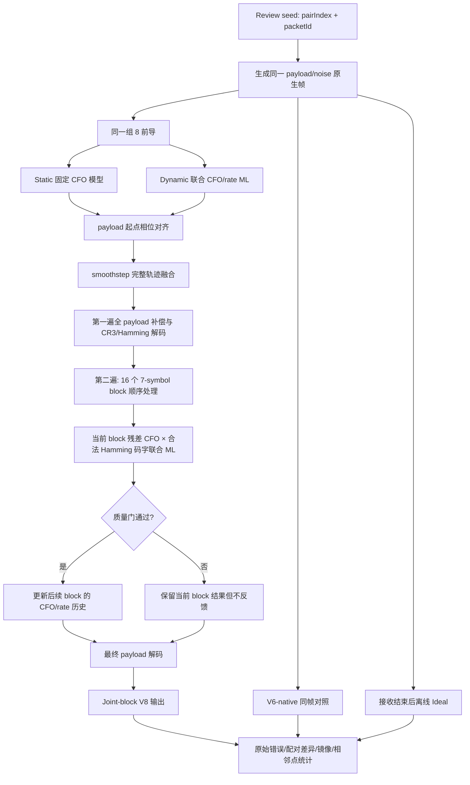

# SenLoRa Symmetric V8 当前代码详细流程

本文描述当前通过独立 Review 并已提升为正式统一入口的 Joint-block 实现。
`senloraSymmetricV8Decode.m` 是正式入口，Formal 尚未启动。

## 1. 文件与职责

| 文件 | 职责 |
|---|---|
| `senloraSymmetricV8Config.m` | 定义原生帧、种子域、`d0/d1` 和固定实验范围 |
| `senloraSymmetricV8GenerateFrame.m` | 生成 8 前导 + 112 payload 的原生帧 |
| `senloraSymmetricV8BlendBootstrap.m` | 对齐并融合 Static/Dynamic 完整相位轨迹 |
| `senloraSymmetricV8Decode.m` | 冻结后的正式统一入口 |
| `senloraSymmetricV8JointBlockDecode.m` | 当前候选接收机；第一遍预测加第二遍逐 block 联合 ML |
| `senloraSymmetricV8LegacyDecode.m` | 原 604-error 失败基线，仅保留作历史对照 |
| `senloraSymmetricV8BlockLikelihood.m` | 单个 7 符号 block 的软 Hamming ML |
| `runSenloraSymmetricV8JointBlockReview.m` | 9×100 独立 Review、检查点和配对统计 |
| `senloraSymmetricV8ReviewSignature.m` | 绑定源码闭包、参数值及参数 JSON 哈希 |
| `plotSenloraSymmetricV8ReviewLogSer.m` | 从已保存 CSV 生成 `-400`–`0 s`、`10^-5`–`10^0` SER 半图；零点不连线 |
| `plotSenloraSymmetricV8FivePointReview.m` | 提取五个指定负轨点，并加入 -21 dB 独立精确 AWGN 理论常数线 |

## 2. 总体数据流



## 3. Review 外层循环

`runSenloraSymmetricV8JointBlockReview.m` 固定执行：

1. 读取 `exp1Config`、V8 plan、V6 plan 和冻结 Stage55 参数；
2. 将 V6 的帧时长设为 V8 原生帧时长，形成 V6-native；
3. 使用 `reviewRootSeed = 1032000000`；
4. 遍历 9 个负轨起点及其物理镜像；
5. 每个镜像对运行 100 个 packet ID；
6. 同一镜像对/packet ID 的两侧共用 payload seed 和 noise seed；
7. 每帧按顺序运行 Joint-block V8、V6-native、离线 Ideal；
8. 每 5 包写一次 `REVIEW_CHECKPOINT.mat`；
9. 完成后生成逐包表、18 点表、Case1/Case2 配对差异、镜像差异、相邻点
   差异和图形。

接收机只接收 `observation`、由相同 8 前导形成的 `common`、通用 PHY 配置和
V8 plan。轨道时刻只用于帧生成器，不送入接收机。

## 4. 原生帧生成

`senloraSymmetricV8GenerateFrame.m`：

1. 调用 `v4BuildNativeFrameLayout(c,false)`；
2. 布局严格为 8 个 bootstrap 前导和 112 个 payload 符号；
3. 不插入 Paper midamble 或空导频槽；
4. payload 由 payload seed 生成并调制；
5. 轨道 Doppler 只在信道生成阶段形成逐样本相位；
6. AWGN 由 noise seed 生成；
7. `observation` 与 `truth` 分离：接收机只得到 `observation`，`truth` 仅在
   解码结束后计算错误和 Ideal。

## 5. 两条前导模型与连续融合

### 5.1 Static

`v4CommonBootstrap` 从同一组 8 前导估计固定 CFO。V8 在 payload 起点取得
Static 起点相位和 Static 固定 CFO，二次项为 0。

### 5.2 Dynamic

`v4Stage55JointPreambleMlBootstrap` 在 8 个已知前导的连续样本上联合估计：

- 第一个前导起点 CFO；
- 一阶 Doppler rate；
- 第一个前导起点相位。

随后 `v4Stage55BootstrapFromJointPreambleMl` 构造连续二次相位多项式。这里的
二次相位只表示恒定 rate，不是二次/高阶轨道动力学模型。

### 5.3 payload 起点对齐与融合

`senloraSymmetricV8BlendBootstrap.m` 先平移 Dynamic 常数相位，使两条展开相位
在 payload 起点完全相同，然后融合完整模型：

```text
predictedDrift = abs(rateHat) * nativeFrameDuration
gain = smoothstep(d0, d1, predictedDrift)

phaseV8(t) = phaseStatic(t)
             + gain * (phaseDynamicAligned(t) - phaseStatic(t))
```

当前候选为 `d0=0.10 bin`、`d1=0.80 bin`：

- `gain=0`：完整轨迹严格为 Static；
- `gain=1`：完整轨迹严格为对齐后的 Dynamic；
- 中间值：常数、CFO 和 rate 项一起连续变化。

## 6. 第一遍解码

`senloraSymmetricV8JointBlockDecode.m` 首先调用 `v4RollingTrackerPass`，候选 VP
mask 全为 false：

1. 使用融合后的 bootstrap CFO/rate 预测整个 payload；
2. 不从 payload 真值或轨道信息获得更新；
3. 补偿全部 112 个符号；
4. `v4DecodePayload` 执行硬符号、CR3/Hamming 硬解码和软 ML 解码；
5. 第一遍结果只作为初始轨迹与诊断，不直接固定第二遍当前 block 的标签。

## 7. 第二遍 Joint-block CFO/Hamming ML

payload 被分成 16 个 block，每个 block 7 个符号，按时间顺序处理。

### 7.1 进入 block 前的因果预测

`localPredictCorrection` 只读取此前通过质量门的 block 历史：

- 没有历史：修正 CFO/rate 均为 0；
- 只有一个或 rate 不可观测：使用加权平均 CFO，rate 为 0；
- 至少两个且 rate 标准差过线：做带 history decay 和 Huber 权重的一阶拟合；
- rate 修正限制在冻结的 `rateDeviationLimitBinsPerSec` 内。

### 7.2 当前 block 的残差搜索

冻结 Stage55 `residualSearchBins` 经既有 `innovationLimitBins` 截断，当前网格：

```text
-0.50, -0.45, ..., 0, ..., +0.45, +0.50 bin
```

对每个候选残差 CFO：

1. 从当前因果 CFO/rate 预测生成该 block 修正轨迹；
2. 对 7 个原始接收符号重新补偿；
3. 调用 `senloraSymmetricV8BlockLikelihood`；
4. 保存该候选的补偿样本、解码结果、结束相位和联合目标值。

候选只存在于当前 block 内。最高目标值候选被保留，其余立即丢弃，没有跨
block rate-bank 或分支拼接。

### 7.3 单 block Hamming ML

`senloraSymmetricV8BlockLikelihood.m` 执行：

1. `v4SymbolLikelihood` 生成每个符号的 1024 维 log probability、硬符号和
   decision peak ratio；
2. 按 Gray bit 集合做 log-sum-exp，形成符号 bit LLR；
3. 对 LLR 做 CR3 对角去交织；
4. 对每个数据行遍历全部合法 Hamming(7,4) 码字；
5. 软分支选择最大码字分数，硬分支选择最小 Hamming 距离；
6. 联合目标为所有数据行最佳合法码字分数之和；
7. 输出最佳/次佳码字 margin、软硬一致性以及重编码符号。

这使当前 block 即使第一遍已经解错，也能利用合法码字约束重新寻找残余
CFO，打破“必须先有正确 VP 才能恢复”的死锁。

### 7.4 质量门与后续反馈

选中的 block 只有同时满足以下既有门限才写入后续历史：

- 硬/软 Hamming 数据一致；
- block 内最小 decision peak ratio 过线；
- 最小码字 margin ratio 过线；
- CFO 搜索最佳/次佳 peak ratio 过线。

无论质量门是否通过，当前 block 都只输出一个选定的 CFO/码字结果；质量门
只决定它能否修正后续 block。最后一个 block 不再向未来写历史。

## 8. 最终输出

16 个 block 的选定补偿样本拼成完整 payload，再调用一次 `v4DecodePayload`，
输出硬/软数据位、符号 CFO、block 残差、peak ratio、margin、接纳标志、
第一遍结果、融合 `gain` 和联合前导估计。所有禁用信息标志保持 false。

## 9. Review 对照与统计

Joint-block V8 完成后，同一帧继续运行：

1. V6-native：相同原生帧和相同 common 前导估计；
2. Ideal：只在两种真实接收机完成后用逐样本真实相位离线补偿。

Review 分析包括：

- Case1：每个 packet 合并镜像两侧，计算 V8−V6-native 配对 SER；
- Case2：计算 V8−Ideal 配对 SER；
- 使用固定分析种子的 10000 次 packet-cluster bootstrap；
- 9 个镜像对逐对检查；
- 18 点形成 17 个相邻转移并检查显著差异和数量级跳变；
- 记录最大单包错误、block 接纳数、最大残差、CFO RMSE、失败和禁用标志。

当前 Review 结果为 Joint-block/V6-native/Ideal = 20/20/16；Case1、Case2
配对差异均为 0；无显著镜像差异或明显相邻跳变。

## 10. 签名、检查点与恢复

`senloraSymmetricV8ReviewSignature.m` 记录：

- Review 身份、种子根、SNR、轨道网格、原生帧时长和 `d0/d1`；
- 执行依赖闭包、显式关键依赖及源码 SHA-256；
- 实际 `commonSearchStepBins`；
- 基础参数 JSON 与 R3 参数 JSON 的路径和 SHA-256。

恢复时严格比较整个 signature。原始运行签名单独保存在
`executionSignatureAtRun`；完成检查点已在全新 MATLAB 会话中验证可直接读取
并重建汇总，不启动并行池或重新生成帧。

## 11. 明确不使用

- Paper midamble 或空导频槽；
- 真实 payload 符号或真实 Doppler；
- 轨道位置、轨道时刻、Case、SNR 或目标 SER 作为接收机输入；
- 逐符号多数投票；
- 跨 block rate-bank、多分支持久化或结果拼接；
- 二次或更高阶轨道动力学模型。

## 12. 当前阶段边界

- 独立 Review：已通过；
- 正式 V8 入口提升：已执行；
- `d0/d1` 冻结：已执行；
- Formal：未启动。

下一步必须先明确 Case2 V8−Ideal 的预注册绝对 SER 容差，之后才能使用第三
组未见种子建立 9000 配对包 Formal。
